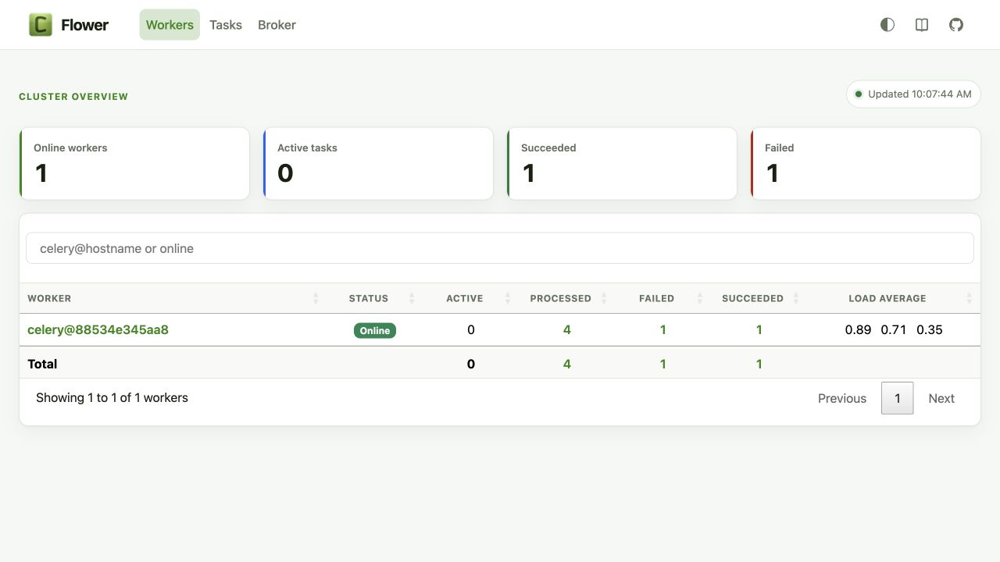

# Message Queues and Async Tasks — acceptance evidence

The existing weekly warehouse/client reporting pipeline was selected for
offloading because it performs multiple database reads and writes, validation,
aggregation, and an optional evaluation export. Running that work inside the
API process would hold a web worker for many seconds. The API now publishes a
small task message and returns `202 Accepted` with a task ID immediately.

## Live Docker acceptance run

The Compose stack ran with one API container, one independent Celery worker,
Redis using `noeviction`, and Flower on port 5555. The successful task was:

- task ID: `60133f63-b8a3-4c3c-be5e-4b6fdfe0eaa7`
- final state: `SUCCESS`
- result: reporting run `Completed`

The controlled failure task was:

- task ID: `5492578a-a469-4a1b-a903-2dcec9e0e13f`
- final state: `FAILURE`
- durable dead-letter row: present, attempt `3`

Retry log excerpt (the invalid window is deliberately non-sensitive test data):

```text
attempt=1 status=retry countdown_seconds=1 error=Invalid isoformat string: 'invalid-window'
attempt=2 status=retry countdown_seconds=2 error=Invalid isoformat string: 'invalid-window'
attempt=3 status=failure duration_seconds=0.000 error=Invalid isoformat string: 'invalid-window'
```



Automated acceptance tests also enforce the sub-200 ms API handoff contract,
task-state mapping, independent worker topology, retry policy, late
acknowledgement, timeouts, structured logs, and durable dead-letter storage.
