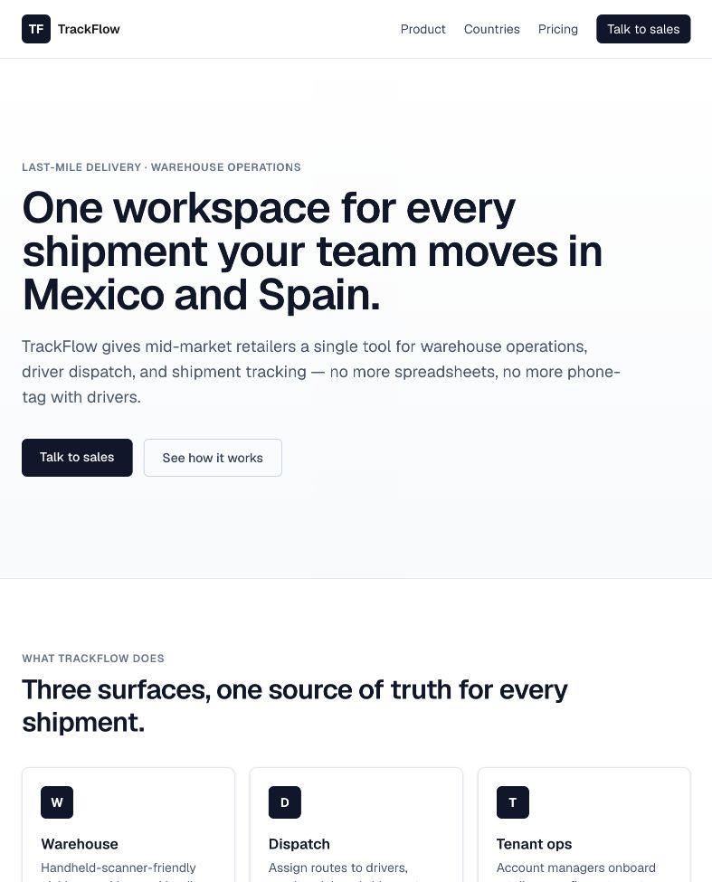
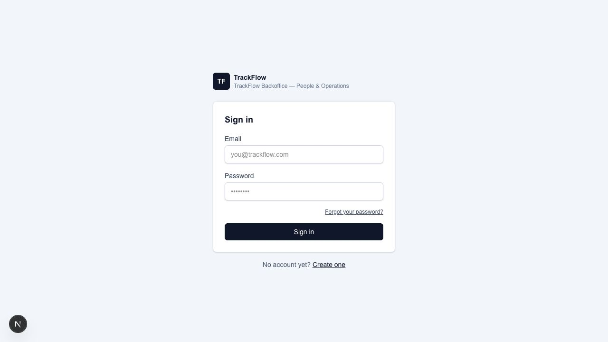
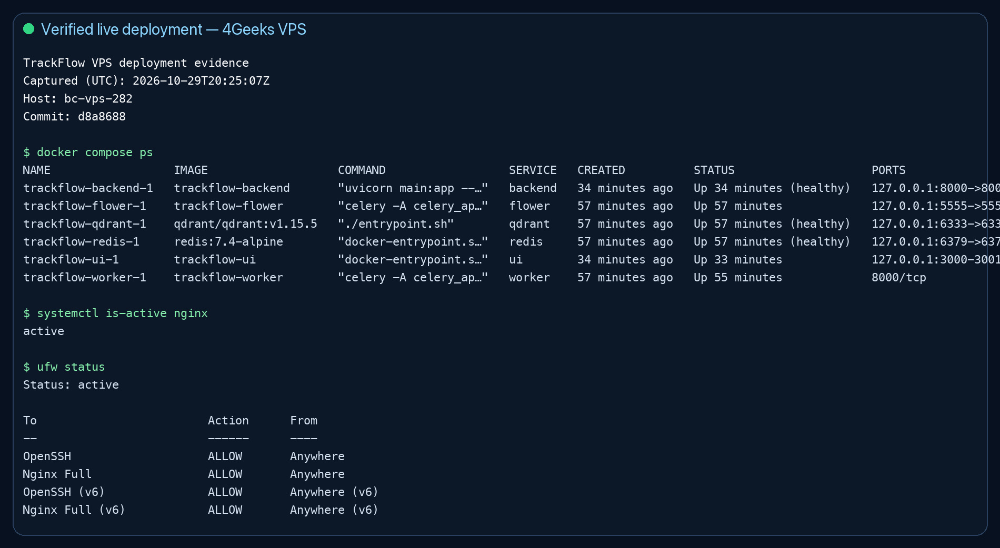

# Company Monorepo Containerization — Assessment Demo

## Submission links

- Repository: <https://github.com/armonon/ai-engineering-company-project-monorepo>
- Pull request with the public-origin deployment fix: <https://github.com/armonon/ai-engineering-company-project-monorepo/pull/79>
- Public website: <https://trackflow.67.205.157.233.nip.io/>
- Backoffice: <https://admin.67.205.157.233.nip.io/login>
- API documentation: <https://api.67.205.157.233.nip.io/docs>

## Evidence screenshots

## Two-minute demo script

1. Open the repository root and identify `uis/Dockerfile`, `services/Dockerfile`, and `docker-compose.yml`.
2. Explain that `docker compose up` starts both Next.js applications in one `ui` container and the FastAPI application in `backend`.
3. Show `docker compose ps`; point out the website/backoffice ports and the healthy backend.
4. Open the website, backoffice login, and FastAPI documentation using the HTTPS links above.
5. Show the UI bind mounts and FastAPI `--reload` command in the Compose/Dockerfile configuration to demonstrate hot reload.
6. Show `TRACKFLOW_API_INTERNAL_URL=http://backend:8000` to demonstrate service-name networking instead of `localhost`.
7. Show that `.env` is ignored and that both `.dockerignore` files exclude environment files, dependencies, build output, logs, and tests as required.

## Rubric verification

| Requirement | Evidence | Result |
| --- | --- | --- |
| Alpine Node UI image | `uis/Dockerfile` starts with `node:22-alpine` | Pass |
| Website and backoffice dependencies installed | UI Dockerfile installs both npm workspaces | Pass |
| One UI container starts both apps | `uis/start.sh` starts ports 3000 and 3001 | Pass |
| UI `.dockerignore` | Excludes `node_modules`, `.next`, `.env*`, and `*.log` | Pass |
| Official Python backend image | `services/Dockerfile` uses `python:3.12-slim` | Pass |
| `uv` dependency installation | Backend installs `uv`, then installs `requirements.txt` | Pass |
| FastAPI hot reload | Backend command runs Uvicorn with `--reload` | Pass |
| Backend `.dockerignore` | Excludes caches, bytecode, `.env*`, tests, logs, and virtual environments | Pass |
| Root Compose file | `docker-compose.yml` orchestrates the platform | Pass |
| UI source bind mounts | Compose mounts `uis` and the shared business-logic package | Pass |
| Backend source bind mounts | Compose mounts the API and shared Python packages | Pass |
| Correct host ports | Website 3000, backoffice 3001, backend 8000 | Pass |
| Explicit Docker network | Services use the named `trackflow-development` network | Pass |
| Service-name communication | UI uses `http://backend:8000` internally | Pass |
| Environment-based configuration | Compose reads `.env`; secrets are not hardcoded in Dockerfiles or Compose | Pass |
| `.env` ignored | Root `.gitignore` contains `.env` and `.env.local` patterns | Pass |
| One-command startup | Verified with the running VPS Compose stack | Pass |

## Live deployment verification

- VPS: `bc-vps-282` (`67.205.157.233`)
- HTTPS: active with automatic certificate renewal
- Firewall: only SSH and Nginx web traffic are public
- Internal application/datastore ports remain bound to `127.0.0.1`
- VPS Git checkout and GitHub `main` were synchronized at the time evidence was captured
- Full GitHub verification passed: typecheck, workspace/API tests, builds, and dependency audit

## What to say if asked why Next.js uses development mode

The ticket explicitly requires hot reloading for the development environment. The default Compose contract therefore uses `next dev` and FastAPI `--reload`. The public VPS exists to demonstrate the same reproducible development stack remotely; a separate production-image workflow would be a follow-up infrastructure ticket, not a replacement for this assignment's required behavior.
