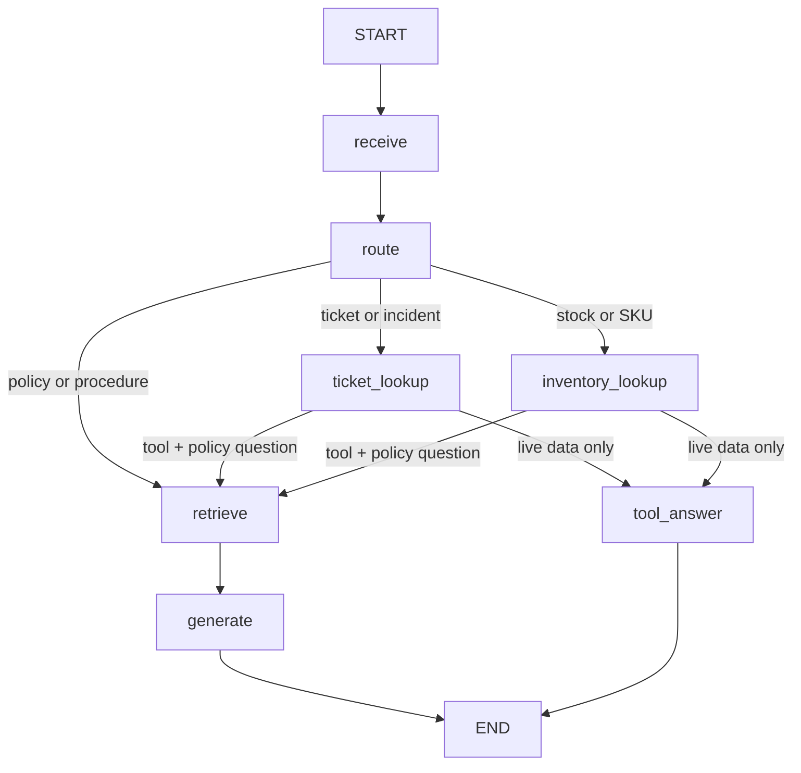

# LangGraph external-tools acceptance evidence

Date: 2026-10-28

The graph now routes automatically among the stable TrackFlow knowledge base,
the existing TinyDB incident manager, and the existing SQLModel inventory
manager. The API injects read-only repository functions; the agent package does
not own or simulate a second operational dataset.



Both tools are single-purpose and read-only. Every call has a numeric four-second
timeout. Missing resources, timeouts, and service failures lead to an explicit
honest answer rather than a fabricated status or stock figure.

`routing-traces.json` contains two exported, queryable graph runs:

- ticket 482 routes to `ticket_lookup` and never invokes RAG;
- a high-demand delivery policy question routes to RAG and never invokes a tool.

Focused acceptance command:

```bash
PYTHONPATH='data/process:data/pipelines:services/agent:services/api' \
  uv run --project services/api pytest \
  tests/pipelines/test_agent_graph.py \
  tests/pipelines/test_agent_evals.py \
  services/api/tests/test_agent.py -q
```

Result: **19 passed**. This includes an API-level test proving the agent reads an
incident first created through the real `/api/incidents` manager.
