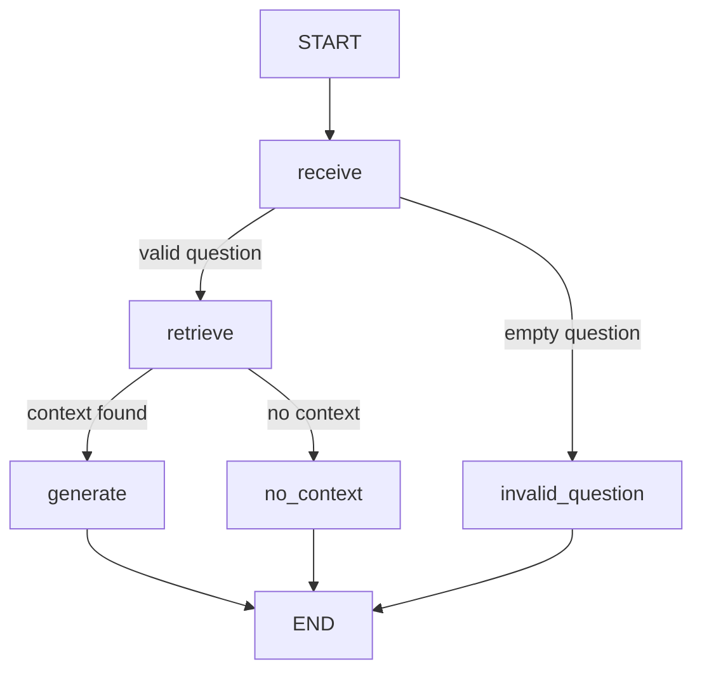

# LangGraph support-agent acceptance evidence

Date: 2026-10-28

The full compiled graph ran locally with an in-memory Qdrant collection,
`nomic-embed-text` for embeddings, and `qwen2.5:7b` for generation. The
exported queryable trace is in `trace.json`.



The trace proves `retrieve` ran once before `generate`, the generation node
received already-retrieved context, and the final answer preserved TrackFlow's
high-demand policy: no promised Black Friday SLA, a possible additional 40%
delivery time, and proactive client communication.

Focused acceptance command:

```bash
PYTHONPATH='data/process:data/pipelines:services/agent:services/api' \
  uv run --project services/api pytest \
  tests/pipelines/test_rag.py \
  tests/pipelines/test_agent_graph.py \
  tests/pipelines/test_agent_evals.py \
  services/api/tests/test_agent.py -q
```

Result: **17 passed**. The three offline evals consume exported trace fixtures,
so they do not require or rerun a live model.
